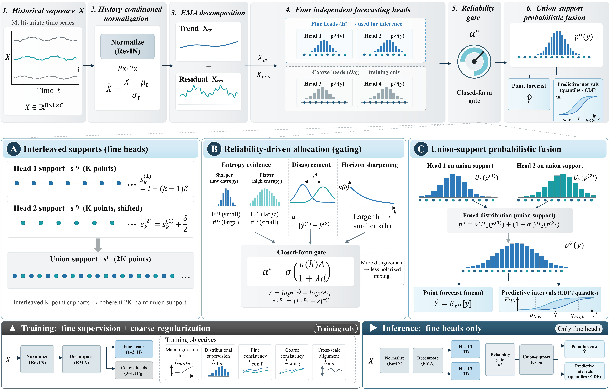

# OepfTSF

**OepfTSF: Reliability-Driven Probabilistic Time-Series Forecasting with Interleaved Supports**

Research repository for our paper prepared for **IEEE ICDE 2027**.

## Overview

OepfTSF is a reliability-driven probabilistic framework for long-term time-series forecasting. It addresses the challenge of combining competing predictive hypotheses whose reliability may vary across inputs and forecast horizons.

The framework constructs complementary predictive distributions on interleaved discrete supports and integrates them through a closed-form reliability allocation mechanism.

The main components include:

- **Interleaved Probabilistic Supports:** Two fine-resolution forecasting heads learn distributions over complementary discrete support grids.
- **Reliability-Driven Allocation:** Predictive entropy, hypothesis disagreement, and horizon-dependent sharpening jointly determine adaptive fusion weights.
- **Coherent Probabilistic Fusion:** The two predictive distributions are combined on a shared union support to produce point forecasts and prediction intervals.
- **Joint Training:** Distributional supervision, within-resolution consistency, and cross-scale alignment improve forecasting reliability.

## Model Architecture

The framework contains four independently parameterized forecasting heads during training. Two fine-resolution heads are retained for inference, while two coarse-resolution heads provide auxiliary regularization.

## Experimental Evaluation

We evaluate OepfTSF on seven widely used time-series forecasting benchmarks:

- ETTh1
- ETTh2
- ETTm1
- ETTm2
- Weather
- Electricity
- Traffic

The main forecasting experiments use:

- Lookback length: 720
- Prediction horizons: 96, 192, 336, 720
- Support locations per head: 25
- Default support range: [-4, 4]

The evaluation includes point forecasting accuracy, probabilistic forecasting quality, controlled ablation studies, support robustness, and computational efficiency.

## Code and Reproducibility

The repository is being organized for reproducibility.

Currently available:
- Model architecture illustration (`model.png`)

Training and evaluation code, environment requirements, and reproduction instructions will be documented here as they become available.

## Citation

Citation information will be updated when available.
